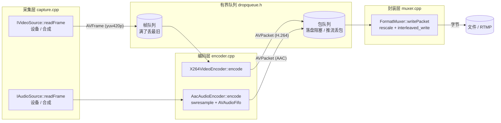

# 采集推流知识点详解（08-05-capture_push）

> 配套源码：同目录 `main.cpp` / `pusher.{h,cpp}` / `capture.{h,cpp}` /
> `encoder.{h,cpp}` / `muxer.{h,cpp}` / `dropqueue.h`
> 参考实现：`QtFFmpegPlayer/Player/QtPlayer/pusher/`
> 环境：Qt 6.11.0 (MinGW 13.1.0) + FFmpeg 8.1；语言 C++17；构建 CMake

---

## 0. 和前面四个工程的根本区别

08-01 ~ 08-04 的数据源都是**文件**：你想多快读就多快读，读完了就结束。
08-05 第一次接上**实时源**（摄像头/麦克风），于是多出一整类问题：

| 问题 | 文件源 | 实时源 |
| --- | --- | --- |
| 速度由谁决定 | 自己（越快越好） | **设备**（到点才出帧，你催不动） |
| 数据会不会丢 | 不会 | **会**（你处理不过来时设备照样往下走） |
| 参数怎么来 | 文件里写着 | **协商**（提议 1280×720，可能给你 640×480） |
| 阻塞读怎么退出 | 读到 EOF 自然结束 | **可能永远阻塞**，必须能叫停 |
| 网络断了怎么办 | 不存在 | **重连 + 等关键帧** |

这五条决定了本工程必须引入：**队列 + 多线程 + 中断回调 + 重连**。

```
  摄像头 ──┐
           ├─► 采集层 ─► 编码层 ─► 封装层 ─► 文件 / RTMP
  麦克风 ──┘
```

---

## 1. 分层与线程模型

### 1.1 五层，每层只对下一层负责

| 文件 | 职责 | 关键点 |
| --- | --- | --- |
| `main.cpp` | 命令行 → 配置；控制运行时长 | 不参与数据通路 |
| `pusher.cpp` | 编排：线程、队列、重连 | 唯一的"总调度" |
| `capture.cpp` | 设备/合成源 → AVFrame | 格式统一、参数协商、节流 |
| `encoder.cpp` | AVFrame → AVPacket | x264 参数、AAC 凑帧 |
| `muxer.cpp` | AVPacket → 文件/网络 | 交织、时间基换算、trailer |
| `dropqueue.h` | 有界队列 | 两种"满了怎么办" |

### 1.2 四条线程，两条队列

```
 [视频采集线程] ──AVFrame──► 帧队列(满则丢最旧) ──► [编码线程] ──AVPacket──┐
                                                                           ├─► 包队列 ──► [写出线程] ──► muxer
 [音频采集线程] ──（就地编码，不走帧队列）────────────────AVPacket──────────┘
```

**为什么音频绕过帧队列**（参考工程也是这么设计的，刻意为之）：

- 视频丢一帧 = 画面抖一下，几乎无感；
- 音频丢一段 = **"咔哒"一声**，体感差得多；
- 麦克风本身带缓冲，编码器偶尔慢一拍它会自然反压，所以音频就地编码、不丢。

**为什么编码和写出要分开**：
x264 是 CPU 密集的，可能偶发慢一拍；写出可能卡在网络。
同一条线程的话：网络卡 200ms → 编码停 200ms → 帧队列堆满 → 丢帧。
分开之后：网络慢只让包队列涨（推流模式丢包），编码和采集照常跑。

---

## 2. 有界队列（`dropqueue.h`）

### 2.1 为什么必须"有界"

无界队列的后果不是崩溃，而是**延迟无限增长**：
网络卡半小时，队列里堆半小时的数据，观众看到的是半小时前的画面 —— 直播里这比崩溃还糟。

### 2.2 两种策略，一个实现

| 场景 | 策略 | 理由 |
| --- | --- | --- |
| 帧队列（采集→编码） | **丢最旧** | 采集是实时源，绝不能让它等 |
| 包队列（编码→**落盘**） | **阻塞等待** | 文件必须完整，等一等无所谓 |
| 包队列（编码→**推流**） | **丢包** | 网络卡住宁可丢，也不能堆延迟 |

`pusher.cpp` 里就这一个判断：

```cpp
m_packetQueue = std::make_unique<PusherPacketQueue>(
    capacity, AvPacketDeleter{},
    /*dropOldestWhenFull=*/isNetworkOutput(m_cfg.output));   // 网络→丢，文件→阻塞
```

### 2.3 `close()` 的语义 —— 决定"优雅退出"能不能写对

```
close() 之后：push() 直接拒绝（并释放元素）
close() 之后：pop() 仍然能把队列里剩下的元素取完，取空后才返回 false
```

如果写成"close 立刻清空队列"，最后一段画面/音频就丢了，mp4 的结尾也不完整。

消费者判断退出的条件必须是 **`closed() && size() == 0`**，不能只看 `closed()`。

---

## 3. 采集层

### 3.1 设备参数是"协商"出来的

提议 1280×720@30，设备可能给 640×480@25。所以顺序**不能颠倒**：

```
先打开采集源（拿到实际值）
  → 用实际值回填 encoder 配置
    → 再打开编码器
```

拿提议值去配编码器，`avcodec_send_frame` 会直接报错或花屏。

### 3.2 格式统一：任何格式 → yuv420p

摄像头给什么五花八门：YUY2 / NV12 / MJPEG 解出来的 yuvj422p……
x264 只认 yuv420p，所以采集层出口统一用 `swscale` 转。

一个优化：源本来就是同尺寸 yuv420p 时，`av_frame_ref` 加个引用就返回，连拷贝都省了。

### 3.3 设备也要"解码"

MJPEG / H.264 摄像头、pcm_s16le 麦克风，对 FFmpeg 来说都是**码流**，
要用 `avcodec_send_packet` / `avcodec_receive_frame` 过一遍解码器才能拿到 AVFrame。
本工程把这段公共逻辑抽成了 `DeviceStream`，视频/音频各复用一次。

### 3.4 时间戳：自己生成，两路同源

设备时间戳有两个麻烦：单位不统一（dshow 是 100ns、v4l2 是自己一套）、
起点不一致（音视频两个设备各自从陌生初值开始）。

所以本工程约定：**两路都从 0 开始，按固定步长累加微秒**

```
视频：pts = 帧序号       * 1000000 / fps
音频：pts = 已读采样点数 * 1000000 / sampleRate
```

好处：两路天然同源，可以直接比大小；而且完全确定性，同输入每次结果一样。
代价：设备实际帧率不稳时会缓慢漂移（真实产品会用设备时间戳做校正）。

### 3.5 中断回调：让阻塞的读能退出

`avformat_open_input` / `av_read_frame` 会长时间阻塞。挂上 `AVIOInterruptCB` 之后，
FFmpeg 会定期轮询它，返回非 0 就放弃当前 I/O（`AVERROR_EXIT`）。

没有它，用户按 Ctrl+C 时线程卡在设备读里，只能强杀进程 —— 文件写不出 trailer。

### 3.6 ⚠ 合成源 / 虚拟摄像头必须自己节流（**实测踩到的坑**）

真实摄像头按 30fps 到点给帧。但**合成源是一段代码**，
`while(1){ 生成一帧 }` 一秒能造几千帧 —— 这不是"性能好"，是**语义错了**：

第一版没做节流，实测结果：

```
命令：capture_push --synthetic-video --synthetic-audio --output out.mp4 --duration 5
结果：exit=0，但生成 2895 帧、容器时长 375 秒（应该是 150 帧 / 5 秒）
```

更意外的是：**AMD Privacy View camera 这个虚拟摄像头也不等帧率**，
4.4 秒拿到了 1630 帧（≈370fps）。所以节流不能只加在合成源上，要加在采集层。

实现要点（`capture.cpp` 的 `sleepUntil` + `lazyStartUs`）：

```
先读（真设备会自己等）→ 再补睡到"这一帧本该出现的时刻"
```

### 3.7 ⚠ 节流的起点必须"惰性"记录（**第二个坑**）

第一版把基准时刻记在 `open()` 里，结果跑 4 秒出了 5 秒的视频。

原因：`open()` 只是打开设备，真正开始出帧要等编码器、输出都开好、线程拉起来，
中间隔着 1 秒以上（dshow 打开两个设备就要 1~2 秒）。
于是"第 0 帧应该在 t=0"这个判断早就过期了，开头 30 帧被瞬间全部放出。

改成**第一帧真要出的时候**才记起点，问题消失。

### 3.8 ⚠ dshow 音频默认 500ms 一块（**第三个坑**）

用临时插桩打印前几帧的 `nb_samples`：

```
[dbg] audio frame nb_samples=24000  ← 24000/48000 = 0.5 秒一块
[dbg] audio frame nb_samples=24000
```

后果：
- 音频时间轴粒度 0.5 秒 → "跑 10 秒"的文件音频可能是 10.5 秒；
- 端到端延迟至少 0.5 秒，直播里很致命。

修法：给 dshow 传 `audio_buffer_size=100`（毫秒）。实测 4 秒的运行，
音视频长度差从 **0.48 秒降到 0.06 秒**（一帧以内）。

### 3.9 ⚠ 为什么每帧新分配 AVFrame，而不是复用一个成员 buffer

看合成源时很容易产生一个疑问：既然每帧都要画一张 yuv420p，
为什么不预先分配一块 buffer 反复用？那样省掉每帧一次 1.3MB（720p）的 alloc/free。

**因为返回的帧会离开 `readFrame()`**：

```
readFrame() 返回 AVFrame* ──► push 进帧队列 ──► 编码线程稍后取走并编码
                                    ↑
                        中间可能隔几十毫秒
```

如果复用同一块 buffer，下一次 `readFrame()` 往里一画，
队列里那个**还没被编码**的帧就跟着变了 —— 编码器拿到的是"半新半旧"的画面，
表现为撕裂或乱帧。

这类 bug 特别难查：它只在"编码比采集慢"（队列积压）时出现，
机器快的时候一切正常，一上负载就花屏。

所以正确做法是二选一：

| 做法 | 说明 |
| --- | --- |
| **每帧新分配**（本工程） | 简单、正确；代价是每帧一次 alloc/free |
| **帧池** | 预分配 N 个，用完归还；性能和内存都可控 —— 生产环境用这个 |

**注意帧池 ≠ 复用同一个 buffer**：池子里同时存在多帧，
队列里的帧和正在画的帧是两块不同的内存，所以不会互相踩。

> 这个坑和 `PacketSink` 那个坑是同一类：
> **只要数据的所有权被交出去了，就不能假设它还在你手里。**
> 帧交给队列、包交给 sink/队列，都必须能"同时存在多份"。

---

## 4. 编码层

### 4.1 x264 的四件关键事

```cpp
m_cc->pix_fmt   = AV_PIX_FMT_YUV420P;            // 必须和喂进来的帧一致
m_cc->time_base = AVRational{1, fps};            // 编码器时间基 = 1/fps（pts 用帧号）
m_cc->framerate = AVRational{fps, 1};            // 写进 VUI，播放器靠它算时长
m_cc->flags    |= AV_CODEC_FLAG_GLOBAL_HEADER;   // SPS/PPS 要作为 extradata 交给 muxer
```

直播必加的两个：

```cpp
av_opt_set(priv_data, "preset", "veryfast",   0);   // 压缩率 ↔ 速度
av_opt_set(priv_data, "tune",   "zerolatency", 0);  // 关前瞻/多帧缓冲，换低延迟
m_cc->max_b_frames = 0;                             // B 帧会让 dts<pts 且加延迟
```

### 4.2 时间基换算 + 零拷贝

```cpp
AVFrame* feed = av_frame_alloc();
av_frame_ref(feed, inYuv420p);                                  // 只复制引用，不拷像素
feed->pts = av_rescale_q(inYuv420p->pts,                        // 微秒
                         m_cfg.inputTimeBase,                   // {1,1000000}
                         m_cc->time_base);                      // {1,fps}
avcodec_send_frame(m_cc, feed);
av_frame_free(&feed);       // send 之后就能还：编码器已引用住（依然零拷贝）
```

不换算的后果：时长离谱、播放器 seek 乱跳。

### 4.3 AAC 比视频多两道工序

| 工序 | 为什么 | 用什么 |
| --- | --- | --- |
| 转采样格式 | AAC 只吃 **fltp**（float + 分平面），设备给的是 s16 交错 | `libswresample` |
| 凑够整帧 | AAC **每帧必须正好 1024 个采样点**，设备一次给的数不固定 | `AVAudioFifo` |

```cpp
// 8.1 里旧的 swr_alloc_set_opts() 已被删除，只有 swr_alloc_set_opts2()
swr_alloc_set_opts2(&swr, &outLayout, AV_SAMPLE_FMT_FLTP, outRate,
                          &inLayout,  inFmt,              inRate, 0, nullptr);
```

音频的 pts 用「累计采样点数」推（`{1, sample_rate}` 的时间基），
因为 FIFO 会重排采样点，**输入帧的边界已经没有意义了**：

```cpp
frame->pts = m_nextPts;
m_nextPts += frame_size;
```

### 4.4 PacketSink：编码器把包"交出去"的那根管子

**为什么需要它**：`encode()` 返回 `bool`，只能回答"这帧喂进去了吗"，
但一次调用可能产出 0 个 / 1 个 / 好几个包（有 B 帧或前瞻时包会延迟出；
`flush()` 时一次吐一堆）。一个 `bool` 装不下"N 个包"，所以要第二条出口：

```
bool encode(AVFrame*)     ← 出口 1：成不成
void sink(AVPacket*)      ← 出口 2：出来了什么
```

**它是什么**：`std::function<void(AVPacket*)>` —— 任何能接收一个 `AVPacket*`
的可调用对象（函数指针 / lambda / 仿函数）。它不规定接收者是谁。

**两侧怎么用**：

```cpp
// 生产侧（encoder.cpp）：产出一个就交一个
if (sink) sink(pkt);

// 消费侧（pusher.cpp）：告诉编码器"包交给谁"
m_videoEnc->setSink([this](AVPacket* pkt) {
    AVPacket* copy = av_packet_clone(pkt);   // 只给码流数据加引用，不拷码流
    if (!copy) return;
    copy->stream_index = m_videoStreamIndex; // 顺手写上正确下标（见 4.5）
    m_packetQueue->push(copy);               // 队列负责 av_packet_free
});
```

编码器不认识队列、也不认识 muxer，它只知道"有人要包，我按这个签名交出去"。
想改成写文件 / 发网络 / 丢进环形缓冲，只改消费侧的 lambda，编码器一行不动 ——
这就是**依赖倒置**：只依赖签名，不依赖具体接收者。

**为什么不用别的写法**：

| 写法 | 问题 |
| --- | --- |
| `std::vector<AVPacket*> encode()` | 每次构造容器；所有权不清（谁 free？） |
| `virtual void onPacket(AVPacket*) = 0` | 编码器得被继承，视频/音频各写一个类，不能用 lambda |
| 把队列指针直接传给编码器 | 编码器绑死在"队列"这个具体类型上 |

**对照 08-04**：那里用的是出参 `Encode(..., std::vector<AVPacket*>& packets)`，
因为主循环单线程、有明确的"编一批 → 写一批"节奏；
本工程编码跑在独立线程、要持续往共享队列里塞，没有"一批"的自然边界。
**两种都对，取决于谁掌握节奏。**

**所有权（最容易错的地方）**：指针是**借用**的，只在回调期间有效。

```
receive_packet(pkt) → sink(pkt) → 【你的代码】→ 返回
→ av_packet_unref(pkt)（编码器收回引用）→ 下一轮复用同一块结构体
```

所以要留在回调之外用，**必须 clone**。直接存原指针 → `unref` 之后 `data`
没了 / 被下一包覆盖 → 随机崩溃或写出垃圾数据。
只在回调里处理（不存），就可以不 clone。

**线程**：sink 在**编码所在线程**被调用 —— 视频在 `encodeLoop`，
音频在 `audioCaptureLoop`（音频就地编码）。所以 lambda 里必须线程安全，
也别做耗时操作：包队列若是阻塞模式（落盘），队列满时 `sink` 会把
编码线程（音频则是**采集线程**）卡住。

### 4.5 stream_index 归谁管（**第六个坑**）

参考工程在编码器里写死 `video=0 / audio=1`。只推"视频+音频"时没问题，
但**只采音频时音频是 0 号流，包却写着 1** —— 写包直接失败。

正确做法：下标由编排层按"实际建了几路"算（`openOutput()`），
编码器只负责交出包，sink 在 clone 之后写上正确下标。
这也符合分层：编码器不该知道自己在容器里排第几。

---

## 5. 封装层

### 5.1 ⚠ `rtmp://` 不能靠扩展名猜格式（**第四个坑，最隐蔽**）

```cpp
avformat_alloc_output_context2(&out, nullptr, nullptr, "rtmp://127.0.0.1/live/demo");
// → 返回 AVERROR(EINVAL)（实测 -22），out 为 NULL
```

原因：`av_guess_format` 靠**文件扩展名**猜。`rtmp://.../live/demo` 没有扩展名 → 猜不出来。

实测对比：

```
av_guess_format(NULL, "out.mp4",                    NULL) → mp4    ✓
av_guess_format(NULL, "rtmp://127.0.0.1/live/demo", NULL) → NULL   ✗
```

所以按协议头自己映射（`muxer.cpp` 的 `effectiveFormat`）：

```cpp
rtmp:// rtsp:// srt://  →  "flv"      // 直播流的事实标准
其它                    →  nullptr    // 交给 FFmpeg 按扩展名猜
```

> 参考工程把这个映射写在 `main.cpp` 的 `guessFormat()` 里。本工程收进 muxer，
> 因为"用什么容器"本来就是输出层的事。

### 5.2 `rw_timeout` + 中断回调

```cpp
av_dict_set(&opts, "rw_timeout", "5000000", 0);   // 单位微秒，网络操作超时
avio_open2(&pb, url, AVIO_FLAG_WRITE, &m_out->interrupt_callback, &opts);
```

落盘时这两个是摆设；推流时是保命参数 —— 没有它们，断网时写操作会永久挂住。

### 5.3 写包：时间基换算 + 交织

```cpp
av_packet_rescale_ts(pkt, srcTb, dstTb);   // pts/dts/duration 三个都要换
pkt->pos = -1;
av_interleaved_write_frame(m_out, pkt);    // 按 dts 排序并内部缓冲；成功后 pkt 被清零
```

改写的 `dstTb` 必须**现查** `st->time_base`：写头之后 muxer 会改写它
（flv → `{1,1000}`；mp4 → 常变成 `{1,90000}` 或 `{1,15360}`）。

### 5.4 ⚠ 写 trailer 之前必须清掉"叫停标志"（**参考工程踩过的坑**）

abort 的目的是打断"卡住的数据写"。但 trailer 是**收尾动作**，
mp4 的 moov（每帧位置/大小索引）就在这一步写出去。

如果标志还立着，中断回调会让 `av_write_trailer` 返回 `AVERROR_EXIT` →
程序正常退出，文件却因为缺 moov 而**打不开**。

```cpp
void writeTrailer() {
    if (m_abortFlag) m_abortFlag->store(false);   // ← 这一行
    av_write_trailer(m_out);
}
```

### 5.5 关闭输出上下文用哪个函数

```cpp
avio_closep(&m_out->pb);          // 先关 IO（会 flush 缓冲）
avformat_free_context(m_out);     // 再释放上下文
```

`avformat_close_input` 是**解封装**用的，拿它关输出上下文属于未定义行为。

---

## 6. 有序停止（`Pusher::stop`）

顺序**不能换**，每一步都在解决"上一步还在产生数据"的问题：

```
1) 叫停采集 + requestStop()
     让卡在 av_read_frame 里的线程立刻返回（靠中断回调）
2) join 视频采集线程
     它退出前会 close() 帧队列 → 告诉编码线程"不会再有新帧"
3) join 音频采集线程
     它退出前会 flush 音频编码器，把最后几包塞进包队列
4) join 编码线程
     把帧队列里剩下的帧编完、flush 视频编码器
     —— 到这里，包队列的两个生产者都结束了
5) close() 包队列
     现在关才安全：推流线程会把存货写完才退出
6) join 推流线程
     写完剩余包 + writeTrailer()；卡在网络写上就靠 m_abortIo 打断
```

顺序换一下就会出问题，比如"先关包队列再 flush 编码器"→
编码器最后吐出的包被队列拒绝，尾部就丢了。

---

## 7. 断线重连

### 7.1 指数退避

```
1s → 2s → 4s → 8s → 15s（上限）
```

断网时立刻疯狂重试只会浪费 CPU，也容易被服务端判成恶意连接。
等待要**分片睡**（每 100ms 检查一次退出标志），否则 stop() 要傻等 15 秒。

### 7.2 重连后必须等关键帧

断线时丢掉的可能是 P 帧。接上之后直接写 P 帧，
解码器没有参考帧可用 → **花屏甚至解不出来**。

所以重连后要等下一个关键帧（I 帧）才开始写。这也解释了
**为什么 gop_size 不能太大**：gop 越长，重连后要等越久才恢复画面。

```cpp
if (m_waitingKeyframe.load() && (pkt->flags & AV_PKT_FLAG_KEY) == 0) {
    av_packet_free(&pkt);   // 丢掉，等关键帧
    continue;
}
```

### 7.3 重连期间不能阻塞

恢复不了的时候要把包丢掉，而不是原地等 ——
否则包队列被塞满，反过来卡住编码线程，整条链雪崩。

---

## 8. 和参考工程的差异

### 8.1 保留的能力（功能未变）

| 能力 | 状态 |
| --- | --- |
| dshow / v4l2 / alsa 真实设备采集 | ✅ 保留 |
| 无硬件也能跑的合成源（画面 / 正弦波） | ✅ 保留 |
| x264 编码 + AAC 编码（含 swr/fifo） | ✅ 保留 |
| 落盘 mp4 / flv | ✅ 保留 |
| RTMP 推流 | ✅ 保留 |
| 断线重连 + 退避 + 等关键帧 | ✅ 保留 |
| 4 线程 + 2 队列 + 两种背压策略 | ✅ 保留 |
| 有序停止、中断回调、rw_timeout | ✅ 保留 |
| gop / preset / zerolatency / CBR 旋钮 | ✅ 保留 |

### 8.2 去掉的东西（都和你"去掉日志"这个目标有关）

| 去掉的 | 原来干什么 | 为什么去掉 |
| --- | --- | --- |
| `qInfo/qWarning` 全部日志 | 打开成功、每秒统计、每包时间戳 | **本次的核心要求** |
| `--list-devices` | 打印系统里的设备名 | 它唯一的输出就是日志；改用 `ffmpeg -list_devices` 查 |
| `--stats-csv` / 每行统计 | 把码率/丢帧/CPU 写进 CSV | 实验数据采集脚手架，不属于推流功能 |
| `--dump-frame`（存 PPM） | 没有预览时"肉眼验收"一帧 | 验证改用 `ffprobe` / `ffplay`（见 §10） |
| `--selftest` | 一键设好合成参数 | 等价于 `--synthetic-video --synthetic-audio` |
| `DropQueue::dropped()` 计数器 | 统计队列丢了多少帧/包 | 统计功能一起去了；想要就在丢帧分支加一行（`dropqueue.h` 已标位置） |

**静默之后怎么判断成败**：靠**退出码**（见 `main.cpp` 文件头）：

| 退出码 | 含义 |
| --- | --- |
| 0 | 正常结束 |
| 1 | 命令行参数错误 |
| 2 | 视频采集源打开失败（设备名错 / 被占用 / 没插） |
| 3 | 视频编码器打开失败（FFmpeg 没编进 libx264？） |
| 4 | 输出打开失败（路径不可写 / 推流地址连不上） |

新增了一个小 API 支撑这件事：`Pusher::startFailure()`。
库自己不打日志、把原因交给调用方呈现，这也是常见的分层做法。

### 8.3 相比参考工程"顺手修掉"的地方

| # | 问题 | 修法 |
| --- | --- | --- |
| 1 | 合成源不节流（5 秒变 375 秒） | 采集层统一按 fps/采样数节流 |
| 2 | 虚拟摄像头不等帧率（4 秒 1600 帧） | 同上，节流加在采集层而不是只加在合成源 |
| 3 | 节流基准记在 `open()` 里 | 改成首帧惰性记录 |
| 4 | dshow 音频 500ms 一块 | 传 `audio_buffer_size=100` |
| 5 | `rtmp://` 猜不出格式 → EINVAL | 按协议头映射到 flv |
| 6 | 编码器写死 `stream_index` | 由编排层按实际流数分配 |
| 7 | 共享指针 + 原子 swap 来叫停 muxer | muxer 只被推流线程碰，用裸成员 + 借用原子标志即可 |

---

## 9. 实测数据

### 9.1 全合成源（不需要任何硬件）

```
capture_push --synthetic-video --synthetic-audio --output out.mp4 --duration 5
```

| 项 | 值 |
| --- | --- |
| 退出码 / 耗时 | 0 / 5.07 s |
| 视频 | h264 1280×720 @30fps，**150 帧**，5.000 s |
| 音频 | aac 48000Hz 立体声，**235 帧**，5.013 s |
| 容器 | mp4，5.013 s，1 454 856 字节 |
| 解码验证 | `ffmpeg -i out.mp4 -f null -` → **exit 0** |

### 9.2 真实设备 → 落盘

```
capture_push --video "video=AMD Privacy View camera" \
             --audio "audio=Microphone (High Definition Audio Device)" \
             --output av.mp4 --duration 4
```

| 项 | 值 |
| --- | --- |
| 视频 | 1280×720，**122 帧**，4.033 s |
| 音频 | 48000Hz 立体声，**193 帧**，4.096 s |
| 音视频长度差 | **0.063 s**（一帧以内，正常） |
| 麦克风响度 | mean −42.5 dB / max −25.8 dB（确实采到了声音，不是静音） |
| 解码验证 | exit 0 |

### 9.3 真实设备 → RTMP 推流

用 `ffmpeg -listen 1` 当接收端（注意它只接**一次**连接，别用端口探测去打断握手）：

```
# 接收端
ffmpeg -listen 1 -i rtmp://127.0.0.1:19354/live/demo -c copy -y recv.flv
# 推流端
capture_push --synthetic-video --synthetic-audio \
             --output rtmp://127.0.0.1:19354/live/demo --duration 3
```

| 场景 | 结果 |
| --- | --- |
| 合成源 → RTMP | 收到 **828 KB** FLV，h264 1280×720 + aac 48000，3.029 s，解码 exit 0 |
| 真实摄像头+麦克风 → RTMP | 收到 FLV，3.121 s，解码 exit 0 |

### 9.4 断线与重连

| 测试 | 结果 |
| --- | --- |
| 推流中途杀掉接收端 | 推流端**不卡死**，4.2 秒内按 `--duration` 正常退出，exit 0 |
| 服务端恢复后重连 | 断流前 **768 KB**，重连后 **1660.9 KB** / 9.109 s，解码 exit 0 ✅ |

### 9.5 四种输入组合

| 组合 | 结果 |
| --- | --- |
| 只视频 | h264，2.000 s，decode exit 0 |
| **只音频** | aac（0 号流），2.069 s，decode exit 0 ← 修掉 stream_index 硬编码之前的版本这里会失败 |
| 视频+音频 | h264(0) + aac(1)，2.026 s，decode exit 0 |
| 视频+音频 → flv | h264 + aac，2.090 s，decode exit 0 |

### 9.6 退出码

| 命令 | 退出码 |
| --- | --- |
| `--help` | 1 |
| 无参数 | 1 |
| 只给 `--output` 不给输入 | 1 |
| 设备名写错 | 2 |
| RTMP 端口没人监听 | 4 |
| 输出路径不可写 | 4 |

---

## 10. 验证与调试命令

```powershell
# 1) 不需要任何硬件，先确认整条链路通
.\build\capture_push.exe --synthetic-video --synthetic-audio --output out.mp4 --duration 5

# 2) 查设备名（本程序不打印日志，用 ffmpeg 查）
ffmpeg -list_devices true -f dshow -i dummy

# 3) 真实摄像头 + 麦克风
.\build\capture_push.exe --video "video=AMD Privacy View camera" `
                         --audio "audio=Microphone (High Definition Audio Device)" `
                         --output av.mp4 --duration 5

# 4) 看结果
ffprobe -show_format -show_streams av.mp4
ffplay av.mp4

# 5) 确认真的采到画面/声音
ffmpeg -v error -i av.mp4 -af volumedetect -f null -     # 看 mean_volume / max_volume
ffmpeg -v error -i av.mp4 -vf "select=eq(n\,30)" -frames:v 1 frame30.png   # 抠一帧看画面

# 6) 本地 RTMP 端到端（ffmpeg 自带接收端）
ffmpeg -listen 1 -i rtmp://127.0.0.1:19354/live/demo -c copy -y recv.flv
.\build\capture_push.exe --synthetic-video --synthetic-audio `
                         --output rtmp://127.0.0.1:19354/live/demo --duration 3

# 7) 看包时间戳是否单调、是否交织
ffprobe -show_packets av.flv | Select-String pts_time
```

> **自己加日志**：本工程正常路径不发一行输出。想观察中间状态，就在
> `pusher.cpp` 的四个 `while` 循环里各加一行 `printf` ——
> 那四处正好是四条线程各自的"心跳点"，加日志不会破坏结构。

---

## 11. 一句话总结每一层

| 层 | 一句话 |
| --- | --- |
| 采集 | 设备给什么就统一转成什么，参数以设备为准，阻塞读必须有出口 |
| 编码 | 时间基要换、帧要零拷贝喂、AAC 要凑够整帧 |
| 封装 | 时间基要现查、`rtmp://` 要显式指格式、trailer 不能被叫停 |
| 编排 | 队列有界且策略要对、拆线程解耦、按固定顺序收尾 |
| 重连 | 退避等待、恢复后等关键帧、恢复不了要丢包不能堵 |

---

## 12. 附录：完整调用链

### 12.1 总体拓扑（4 线程 + 2 队列 + 3 种数据形态）



数据形态的三次变化：

| 阶段 | 类型 | 内容 |
| --- | --- | --- |
| 采集 | `AVFrame` | yuv420p 像素 / PCM 采样 |
| 编码 | `AVPacket` | H.264 / AAC 码流 |
| 写出 | 字节 | 容器封装后的数据 |

### 12.2 启动链（`main.cpp:239` → `Pusher::start()`，`pusher.cpp:58`）

```
main()
├─ 解析 argv → PusherConfig
├─ std::signal(SIGINT, onSignal)
└─ Pusher::start()                                  pusher.cpp:58
   ├─ createVideoSource(cfg)
   │   └─ DeviceVideoSource::open()  /  SyntheticVideoSource::open()
   │      └─ DeviceStream::open()
   │         ├─ avdevice_register_all()             ← 必须调（知识点 40）
   │         ├─ avformat_alloc_context() + 挂 interrupt_callback
   │         ├─ av_find_input_format("dshow")
   │         ├─ avformat_open_input(&fmt, "video=...", ifmt, &opts)
   │         ├─ avformat_find_stream_info()
   │         └─ avcodec_find_decoder / alloc_context3 / parameters_to_context / open2
   ├─ 用 m_video->width()/height()/fps() 回填 m_cfg.encoder   ← 提议≠结果
   ├─ createAudioSource + open()                    （同上，AVMEDIA_TYPE_AUDIO）
   ├─ createVideoEncoder() → X264VideoEncoder::open()
   │   ├─ avcodec_find_encoder_by_name("libx264")
   │   ├─ avcodec_alloc_context3 + width/height/pix_fmt/time_base/framerate/gop/bframes/bit_rate
   │   ├─ flags |= AV_CODEC_FLAG_GLOBAL_HEADER
   │   ├─ av_opt_set(preset) / av_opt_set(tune=zerolatency)
   │   ├─ avcodec_open2()
   │   └─ avcodec_parameters_alloc + from_context()  → codecpar()
   ├─ m_videoEnc->setSink(lambda)                    ← 建立"包出口"（知识点 10）
   ├─ createAudioEncoder() → AacAudioEncoder::open()
   │   ├─ avcodec_open2()（fltp / ch_layout / GLOBAL_HEADER）
   │   ├─ swr_alloc_set_opts2() + swr_init()
   │   ├─ av_audio_fifo_alloc()
   │   └─ av_frame_alloc + av_frame_get_buffer()      ← 复用的整帧输出
   ├─ openOutput()                                   pusher.cpp:248
   │   ├─ m_muxer->open(cfg, &m_abortIo)
   │   │   └─ FormatMuxer::open()   muxer.cpp
   │   │      ├─ effectiveFormat(cfg)                ← rtmp:// → flv（知识点 38）
   │   │      ├─ avformat_alloc_output_context2()
   │   │      ├─ 挂 interrupt_callback
   │   │      └─ avio_open2(..., rw_timeout)
   │   ├─ m_muxer->addStream(videoEnc->codecpar(), videoEnc->timeBase())
   │   │   └─ avformat_new_stream + avcodec_parameters_copy
   │   ├─ m_muxer->addStream(audioEnc->codecpar(), ...)   ← 这里定下 stream_index
   │   └─ m_muxer->writeHeader() → avformat_write_header
   └─ 起 4 条线程：videoCaptureLoop / audioCaptureLoop / encodeLoop / pushLoop
```

### 12.3 运行链：四条线程各自的调用栈

**线程 A —— 视频采集**（`pusher.cpp:325`）

```
videoCaptureLoop()
└─ while (m_running)
   ├─ m_video->readFrame()
   │   ├─ DeviceVideoSource::readFrame()
   │   │   ├─ DeviceStream::nextFrame()
   │   │   │   └─ avcodec_receive_frame / av_read_frame / avcodec_send_packet  (循环)
   │   │   ├─ FrameConverter::ensure() / convert()
   │   │   │   └─ sws_scale()                        ← 任意格式 → yuv420p
   │   │   ├─ sleepUntil(due, lazyStartUs(m_startUs), m_stop)   ← 帧率限制
   │   │   └─ pts = 帧序号 * 1e6 / fps
   │   └─ SyntheticVideoSource::readFrame()
   │       ├─ sleepUntil(...)                        ← 合成源自己造节奏
   │       ├─ av_frame_alloc + av_frame_get_buffer   ← 每帧新分配（知识点 39）
   │       ├─ draw()
   │       └─ pts = 帧序号 * 1e6 / fps
   └─ m_frameQueue->push(frame)                      ← 满了丢最旧
```

**线程 B —— 音频采集 + 就地编码**（`pusher.cpp:341`）

```
audioCaptureLoop()
└─ while (m_running)
   ├─ m_audio->readFrame()   → DeviceStream::nextFrame + sleepUntil
   └─ m_audioEnc->encode(frame)
      └─ AacAudioEncoder::encode()
         ├─ swr_get_out_samples()
         ├─ swr_convert()                  → m_tmp
         ├─ av_audio_fifo_write()
         └─ while (av_audio_fifo_size() >= frame_size)
            ├─ av_audio_fifo_read()        → m_frame（正好 1024 采样）
            ├─ m_frame->pts = m_nextPts
            ├─ avcodec_send_frame()
            └─ drainToSink()  ──► sink()  ──► av_packet_clone ──► m_packetQueue->push
（退出前）m_audioEnc->flush() → send_frame(nullptr) + drainToSink
```

**线程 C —— 视频编码**（`pusher.cpp:360`）

```
encodeLoop()
└─ for (;;)
   ├─ m_frameQueue->pop(frame, 50)                  ← closed && empty 才 break
   ├─ m_videoEnc->encode(frame)
   │   └─ X264VideoEncoder::encode()
   │      ├─ 格式 / 尺寸校验
   │      ├─ av_frame_alloc + av_frame_ref          ← 零拷贝
   │      ├─ av_rescale_q(pts, {1,1e6} → {1,fps})   ← 时间基换算
   │      ├─ avcodec_send_frame()
   │      ├─ av_frame_free(&feed)
   │      └─ drainToSink()  ──► sink()  ──► av_packet_clone ──► m_packetQueue->push
   └─ av_frame_free(&frame)
（退出前）m_videoEnc->flush()
```

**线程 D —— 写出（唯一碰 muxer 的线程）**（`pusher.cpp:382`）

```
pushLoop()
└─ for (;;)
   ├─ m_packetQueue->pop(pkt, 50)
   ├─ if (!m_outputReady) reconnect()               ← pusher.cpp:279（含退避 + openOutput）
   ├─ 关键帧门控：只认"视频流 + KEY"（知识点 30 的坑）
   └─ m_muxer->writePacket(pkt)
      └─ FormatMuxer::writePacket()
         ├─ av_packet_rescale_ts(编码器 tb → st->time_base)   ← 必须现查
         ├─ pkt->pos = -1
         ├─ av_interleaved_write_frame()            ← 按 dts 交织；失败 → return false
         └─ av_packet_free(&pkt)
（退出前）m_muxer->writeTrailer() → 清 abort 标志 + av_write_trailer
          m_muxer->close()      → avio_closep + avformat_free_context
```

### 12.4 停止链（`main.cpp:273` → `Pusher::stop()`，`pusher.cpp:202`）

```
main → Pusher::stop()（幂等）
1) m_video / m_audio->requestStop()
      → 各自 m_stop = true → 打断 sleepUntil / av_read_frame（中断回调）
2) join m_videoThread
      → videoCaptureLoop 末尾 m_frameQueue->close()   （告知"不再有新帧"）
3) join m_audioThread
      → 退出前 flush 音频编码器，尾包进包队列
4) join m_encodeThread
      → 帧队列消费干净后 flush 视频编码器
5) [仅网络输出] m_abortIo = true；m_packetQueue->close()
6) join m_pushThread
      → 把存货写完 → writeTrailer（内部先清 abort 标志）→ close
7) 关闭采集源、释放编码器
```

顺序的因果关系一句话：**每一步都在解决"上一步还在产生数据"**。

